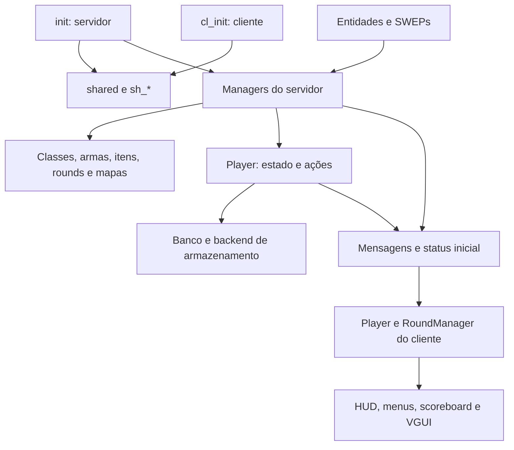

# Diagnóstico e plano de migração

Registro histórico da revisão inicial de 10/10/2026, anterior à conversão completa.
O estado atualizado e as correções aplicadas estão no [guia de desenvolvimento](typescript-migration.md).
Os números e achados abaixo descrevem o ponto de partida. A recomendação inicial
é continuar a migração incremental, corrigindo falhas comprovadas em mudanças
separadas da conversão. Não há necessidade de reescrever o gamemode inteiro ou
trocar sua arquitetura antes de obter tipagem útil.

Esta etapa documenta os achados; não aplica as correções abaixo nem converte
novos arquivos. Os seis arquivos já migrados continuam como estão.

## Escopo e tamanho

O inventário percorreu todos os `.lua` em `gamemodes/`, pesquisando includes,
referências a managers, mensagens de rede, hooks e registros de conteúdo. A
leitura manual se concentrou nos carregadores, núcleo e fronteiras de dados;
os registros repetitivos foram examinados por estrutura e amostragem. Isso é
um diagnóstico de arquitetura e riscos, não uma certificação de cada linha.

| Grupo | Arquivos Lua | Linhas aproximadas |
| --- | ---: | ---: |
| Núcleo na raiz de `gamemode/` | 34 | 5.367 |
| Registros de armas em `gamemode/weapons/` | 154 | 628 |
| Classes humanas e zumbis | 18 | 347 |
| Itens extras | 21 | 406 |
| Idiomas em arquivos próprios | 7 | 1.353 |
| Configurações de mapas | 2 | 18 |
| Backend de banco | 1 | 14 |
| Componentes VGUI | 2 | 325 |
| Entidades e SWEPs | 6 | 1.102 |
| **Total** | **245** | **9.560** |

As linhas incluem comentários e linhas vazias. Inglês também é definido dentro
de `sv_language.lua`. Os 154 registros de armas não são 154 implementações de
SWEP: são predominantemente dados que apontam para armas do jogo ou de addons.

Seis arquivos têm fonte TypeScript: `shared`, `sh_roundmanager`, `sh_player`,
`sh_bank`, `sh_playermanager` e `init`. Os outros 239 ainda têm fonte Lua.
O inventário identificou 49 nomes literais de mensagens de rede; menus também
selecionam dinamicamente o nome da mensagem de resposta.

## Carregamento e dependências

O servidor entra por `init.lua`, que carrega `shared.lua` e os arquivos `sv_*`.
O cliente entra por `cl_init.lua`, que carrega `shared.lua` e os arquivos `cl_*`.
O compartilhado estabelece equipes, constantes, metatable de Player e contratos
comuns. `AddCSLuaFile` distribui os arquivos necessários ao cliente.

No hook `Initialize`, a ordem explícita é: idiomas, classes, rounds, armas,
itens extras e configurações de mapas. O banco carrega seu backend e instala
hooks/timer durante o include de `sv_bank.lua`.

O desenho representa dependências principais, não uma ordem total de execução.
`sv_player.lua`, `sv_roundmanager.lua` e `sv_eventmanager.lua` concentram regras
e dependem uns dos outros. A migração deve preservar seus objetos públicos e
adicionar contratos progressivamente, evitando substituí-los por instâncias
incompatíveis com o código Lua restante.

Os loaders de classes, armas, itens e mapas preenchem globais temporárias
(`ZPClass`, `Weapon`, `ExtraItem`, `MapConfig`) antes de executar `include`.
Isso é parte da API de extensão atual. Além disso, `Utils:RecursiveFileSearch`
devolve uma tabela com chaves textuais; não se deve convertê-la automaticamente
em array ou presumir ordem de carregamento.

## Problemas para corrigir antes de ampliar a migração

P1 indica falha de carregamento ou entrada controlável pelo cliente que altera
estado indevidamente ou pode causar erro no handler. P2 indica comportamento
incorreto ou falha dependente de configuração/extensão. A prioridade é proposta
de trabalho; os efeitos abaixo foram deduzidos do código, sem executar o GMod.

### P1 — flags de convars recebem a descrição

Em [sv_eventmanager.lua](../gamemodes/zombieplague/gamemode/sv_eventmanager.lua),
linhas 6, 8 e 10, as chamadas de `CreateConVar` têm três argumentos; a descrição
ocupa o lugar das flags. O wrapper em
[sv_convar.lua](../gamemodes/zombieplague/gamemode/sv_convar.lua), linha 2,
repassa os argumentos sem normalização. Isso viola a assinatura do engine e
pode interromper o carregamento desse arquivo.

Correção: fornecer flags e descrição separadamente; tipar o wrapper com ambos
os parâmetros obrigatórios. Confirmar carregamento em uma sessão nova. A API
oficial admite flags numéricas ou uma tabela sequencial de números, conforme
[CreateConVar](https://wiki.facepunch.com/gmod/Global.CreateConVar).

### P1 — sincronização inicial também reinscreve o jogador

O receiver `RequestServerStatus` em
[init.ts](../src/gamemodes/zombieplague/gamemode/init.ts) chama
`AddPlayerToPlay` em toda requisição. Em
[sv_roundmanager.lua](../gamemodes/zombieplague/gamemode/sv_roundmanager.lua),
linha 316, essa função insere o jogador sem verificar duplicidade e muda sua
equipe para humanos. Repetir a mensagem pode duplicar participantes e modificar
a equipe durante a partida.

Correção: tornar o cadastro idempotente e separar pedido de snapshot da decisão
de entrar na partida. Testar duas requisições do mesmo jogador, inclusive
quando ele já é zumbi ou espectador. O teste atual do init usa um manager
simulado: verifica a chamada, mas não protege contra esse efeito do legado.

### P1 — votação sem validação do candidato e sem limite por jogador

Em [sv_votemap.lua](../gamemodes/zombieplague/gamemode/sv_votemap.lua), linha 105,
`SendVotemap` aceita qualquer string enquanto a votação está aberta. Candidato
inexistente produz aritmética com `nil`; mensagens repetidas somam novos votos
do mesmo remetente. O menu fechar no cliente não impõe uma regra no servidor.

Correção: validar o candidato na lista atual e registrar voto por identidade do
jogador. Definir se um segundo envio é ignorado ou substitui o voto anterior.
Também tratar uma votação sem candidatos antes de acessar `MapsToVote[1].Map`
em `EndVotemap`. Testar candidato inválido, repetição, empate e lista vazia.

### P1 — seleção de armas confia na estrutura de uma tabela recebida

Os três receivers `SendPrimaryWeapon`, `SendSecondaryWeapon` e `SendMeleeWeapon`
em [sv_weaponmanager.lua](../gamemodes/zombieplague/gamemode/sv_weaponmanager.lua),
linhas 236, 261 e 286, acessam diretamente
`net.ReadTable().ShouldSaveWeapon.Value`. Uma tabela vazia ou com outra estrutura
gera erro. Também não há nesses handlers uma guarda explícita de equipe/vida;
a busca pode retornar `nil` para um ID desconhecido.

Correção inicial: validar estrutura, booleano, ID, equipe e estado permitido
antes de alterar seleção ou entregar arma. Conferir como a opção de salvar deve
funcionar durante uma vida. Depois, em mudança coordenada de cliente e servidor,
substituir a tabela de uma única opção por um booleano no protocolo. Testar as
três categorias, payload incompleto e chamadas por zumbi/espectador.

### P1 — fallback de classe usa variável fora do escopo

Em [sv_classmanager.lua](../gamemodes/zombieplague/gamemode/sv_classmanager.lua),
linha 63, `GetZPClass` usa `ZPTeamClasses`, mas essa variável só existe como local
em outra função. Um ID desconhecido, inclusive enviado pelos receivers de
seleção de classes, chega a esse fallback inválido.

No mesmo arquivo, `SetZPClass` chama `GetHumanClass`/`GetZombieClass` no manager,
sem implementações encontradas no repositório. `AddZPClass`, linha 53, referencia
`ZombieClass` em vez do argumento `ZPClass` na condição de validação.

Correção: resolver o registro da equipe uma vez, validar ID e equipe na entrada
e decidir explicitamente entre rejeitar e selecionar uma classe padrão.
Corrigir os métodos auxiliares e a validação. Testar IDs válidos, desconhecidos,
registro vazio e equipe inválida. Tipos devem representar busca opcional.

### P2 — saída de jogador perde a equipe antes de decidir a reposição

Em [sv_roundmanager.lua](../gamemodes/zombieplague/gamemode/sv_roundmanager.lua),
linha 325, `RemovePlayerToPlay` muda a equipe para espectador e depois testa
`IsZombie()`/`IsHuman()`. Esses métodos consultam a equipe atual, portanto os
dois ramos de reposição deixam de reconhecer a equipe anterior.

Correção: capturar a equipe anterior antes da mudança. Testar saída do último
zumbi, do último humano e de espectador, tanto por menu quanto por desconexão.

### P2 — limpeza de itens escuta outro nome de evento

Em [sv_extraitems.lua](../gamemodes/zombieplague/gamemode/sv_extraitems.lua),
linha 108, a limpeza escuta `ZPRoundEnd`; o round emite `ZPEndRound` em
[sv_roundmanager.lua](../gamemodes/zombieplague/gamemode/sv_roundmanager.lua),
linha 251. A limpeza também usa `table.Remove`, sem implementação encontrada
no projeto; a biblioteca documentada oferece `table.remove`.

Correção: alinhar o evento e remover/executar callbacks com a API correta.
Testar callbacks acumulados, fila vazia e execução única no fim da rodada.
Referência: [biblioteca table do GMod](https://wiki.facepunch.com/gmod/table).

### P2 — dano de queda e excedente da armadura

Em [sv_player.lua](../gamemodes/zombieplague/gamemode/sv_player.lua), linha 207,
`ShouldTakeFallDamage` usa constantes numéricas onde deveria comparar o modo
selecionado. Com a guarda inicial satisfeita, os termos de equipe podem devolver
números verdadeiros em Lua, permitindo dano para a equipe errada. O texto da
convar em `sv_eventmanager.lua`, linha 3, também numera os modos de 1 a 4,
enquanto as constantes usam 0 a 3.

Em `TakeArmorDamage`, linha 238, a armadura negativa é zerada antes do retorno
do excedente no modo realista. O excedente retornado torna-se sempre zero nesse
ramo. Confirmar a regra pretendida e preservar o restante antes de limitar a
armadura: com 10 de armadura e 15 de dano, o cenário deve explicitar se os 5
restantes atingem a vida. Testar todos os modos de queda, ambas as equipes,
políticas da classe e dano menor/igual/maior que a armadura.

### P2 — configurações declaradas e configurações lidas divergem

Em [sv_eventmanager.lua](../gamemodes/zombieplague/gamemode/sv_eventmanager.lua),
linhas 410 e 413, a decisão de drenar fôlego lê `zp_water_should_drain` e
`zp_run_should_drain`, sem declarações encontradas no projeto. As convars
declaradas `zp_water_drain` e `zp_run_drain` são usadas como quantidade.
Separar claramente ativação e quantidade, com valores padrão documentados.

No mesmo arquivo, linha 312, a recompensa por matar humano lê
`zp_ap_kill_zombie`, embora `zp_ap_kill_human` seja declarada em `sv_config.lua`.
Testar valores diferentes nas duas configurações para comprovar o comportamento.

### P2 — extensão de rounds falha ao carregar arquivos externos

Em [sv_roundmanager.lua](../gamemodes/zombieplague/gamemode/sv_roundmanager.lua),
linha 29, o loader chama `include(Files)` com a coleção inteira; deveria usar
o caminho individual. `RoundToAdd` é local ao loader, sem contrato de retorno
do include, e `AddRoundType(RoundToAdd)` não fornece os dois argumentos da API.
Não há arquivos de rounds externos distribuídos neste inventário: o problema
afeta esse caminho de extensão, não demonstra falha dos seis rounds embutidos.

Correção: definir um contrato explícito de registro com ID e definição; manter
um adaptador documentado caso extensões existentes precisem do formato antigo.
Testar um round externo mínimo e um registro inválido.

## Robustez a tratar no respectivo sistema

- **Persistência:** `bankstorage/text.lua`, linha 8, pode retornar `nil` se o
  arquivo contiver texto não numérico. Validar saldo finito e faixa permitida
  antes de atualizar Player. `Bank:Save` distingue exceção de sucesso via
  `pcall`, mas não interpreta retorno `false` de um backend; documentar se o
  backend deve lançar erro ou retornar um resultado, antes de adicionar outro.
  Manter SteamID64 como string e o diretório de dados atual.
- **Preferências locais:** `cl_keymanager.lua`, linha 48, e `cl_hud.lua`, linha
  170, usam JSON sem validar resultado/estrutura. Arquivo inválido ou campos
  antigos devem recuperar defaults, preservando os campos reconhecidos.
- **Idioma atual:** `cl_language.lua`, linha 7, atualiza o livro e salva o ID,
  mas não atualiza `Dictionary.LanguageID` em memória. Corrigir no mesmo lote
  de idiomas e testar troca seguida de nova sincronização.
- **Menus:** `cl_menu.lua` calcula capacidade com `7 - quantidade de opções
  fixas`, mas calcula navegação usando divisão por 7. Testar mais de uma página
  com opções fixas antes de converter esse código.
- **Entidades/habilidades:** timers capturam Player, SWEP ou entidade. Revisar
  validade na execução e remoção dos timers quando o objeto sai do jogo. A
  granada base agenda dois segundos em `Arm`, embora exponha `ExplosionDelay`.
  Validar a semântica pretendida, previsão e divisão SERVER/CLIENT no motor.
- **Desempenho:** há loops frequentes e setters que fazem broadcast de estado.
  Medir tráfego e tempo de hooks com jogadores reais antes de otimizar. Esta
  análise não mediu latência, FPS nem custo de rede.

## Contratos de TypeScript que faltam

| Fronteira | Contrato necessário |
| --- | --- |
| Player | Base compartilhada e tipos distintos de servidor/cliente; classe é tabela no servidor e nome string no cliente |
| RoundManager | API comum pequena, extensão do servidor, timer local do cliente e transições de estado explícitas |
| Classes | Definições humanas/zumbis, defaults, habilidade opcional e callbacks com convenção de `self` explícita |
| Armas | Registro de dados separado do objeto SWEP do engine; busca retorna definição ou ausência |
| Itens | Preço, condição de compra, ação e cleanup; regras da compra verificadas no servidor |
| Rede | Nome, direção, campos, ordem de leitura/escrita e validação de cada entrada |
| Banco | Interface do backend com semântica de sucesso/erro e assinatura correta de chamadas com/sem `self` |
| UI/idiomas/mapas | DTOs de menu, configurações persistidas, chaves de tradução, contexto dos callbacks de mapa e painel |

Hoje `tsconfig.json` inclui todas as declarações juntas. `types/server.d.ts`
contém assinaturas exclusivas do servidor, como o remetente em `net.Receive`.
Antes de migrar código cliente, criar contextos de compilação distintos para
servidor e cliente, ambos com os tipos compartilhados, sem sobrescrever saídas
compartilhadas de forma conflitante. O build precisará validar todos os contextos
antes de copiar qualquer saída. Um teste negativo deve impedir API de servidor
em fonte cliente e vice-versa.

As declarações `.d.ts` descrevem o legado; não comprovam que ele as cumpre.
Evitar esconder ausência de contrato com `any` ou casts amplos. Dados de rede,
JSON, arquivos e buscas exigem validação em runtime. Centralizar nomes de hooks
e mensagens ajuda a evitar erros de digitação, mas nomes de hooks dinâmicos
por SteamID64 continuam precisando de um contrato próprio.

Para reduzir `_G`, podemos declarar globais públicas mutáveis com tipos precisos
e atribuí-las diretamente, conferindo o Lua emitido. Isso é uma melhoria de
legibilidade separada. Globais de integração com GMod e addons continuam
necessárias; detalhes internos devem ficar locais.

## Sequência proposta

| Etapa | Entrega | Critério de conclusão |
| --- | --- | --- |
| 1. Estabilização | Corrigir os achados P1 e os bugs do núcleo em alterações pequenas, separadas da conversão | Regressões relevantes cobertas e partida de referência no GMod |
| 2. Base de tipos | Separar realms, definir Player, DTOs de rede, callbacks e registros | Compilação dos contextos e testes negativos de fronteiras |
| 3. Serviços menores | Utils, comandos/convars, mensagens, idiomas, banco/backend e mapas | Defaults, permissões, persistência e protocolos preservados |
| 4. Classes e habilidades | ClassManager e seus 18 registros | Todos carregam; seleção, ativação e reset funcionam |
| 5. Armas e itens | WeaponManager, registros, ExtraItemsManager e compras | IDs/condições validados, compra e cleanup corretos; addons opcionais ausentes tratados |
| 6. Partida | Player servidor, infecção, rounds, eventos e votação em sublotes | Entrada/saída, fim de round, seis modos e votação verificados |
| 7. Cliente | cl_init, estado, mensagens, HUD, menus, teclas, scoreboard e VGUI | Snapshot/eventos coerentes; preferências e UI verificadas |
| 8. Entidades e fechamento | SWEPs, granadas, conteúdo restante e documentação das extensões | Engine/previsão verificados; todos os arquivos de código próprio têm fonte TS |

As interfaces necessárias a uma etapa podem ser declaradas antes da conversão
do sistema que as implementa. Não converter todos os arquivos de Player ou
eventos de uma vez: migrar grupos de métodos/regras com dependências conhecidas,
usando adaptadores temporários quando necessário e sem definições duplicadas.
Os registros de armas devem manter caminhos/IDs ou ter um loader alterado junto;
agrupá-los em dados não pode fazer os includes legados deixarem de encontrá-los.

Para cada lote: registrar o comportamento esperado, corrigir bugs em uma mudança
identificável, converter sem novas mudanças de regra, conferir o Lua emitido,
executar build/testes pertinentes e validar no GMod. Manter API pública e nomes
de rede durante a conversão; mudanças de protocolo exigem atualizar ambos os
lados no mesmo lote. Estender a lista de testes com cenários de negócio, sem
duplicar testes que apenas repetem a implementação.

O próximo lote recomendado é a estabilização: começar pelas três chamadas de
convar, cadastro repetido, validação de votação/armas e resolução de classes.
Não é preciso aguardar uma refatoração geral para resolver esses pontos.

## Estado da validação e resultado final desejado

`npm test` passou nesta revisão: checagem de tipos, conferência dos seis Lua
gerados e 13 testes automatizados. Eles protegem a migração já feita e o build;
não exercitam todos os managers legados nem reproduzem os achados acima.
O runtime de teste é Fengari com API simulada; a sintaxe emitida é verificada
como Lua 5.1. Nenhuma partida real foi executada nesta revisão.

No estado final, `src/` será a fonte do código próprio e `gamemodes/` receberá
Lua gerado para execução. Os `.lua` terão o papel de artefato de build, mas
continuarão sendo código-fonte textual, diferente do bytecode `.class` de Java.
Assets, metadados e dependências externas não se tornam TypeScript. Até concluir
a migração, editar o TS dos seis migrados e o Lua dos demais. Não apagar o Lua
legado nem fazer limpeza geral de `gamemodes/` durante o build.
